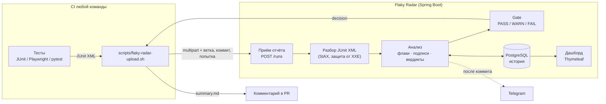

# Flaky Radar

[](https://github.com/doubleduck1/library-test-framework/actions/workflows/tests.yml)
[](https://doubleduck1.github.io/library-test-framework/flaky-radar/jacoco/)


**Flaky Radar** — сервис анализа результатов автотестов. CI любой команды отправляет отчёт JUnit XML
(JUnit/Surefire, Playwright, pytest), а сервис отвечает на вопрос, который обычно решают вручную:
*это упало из-за моих изменений или тест снова «моргнул»?*

- хранит историю каждого теста в PostgreSQL;
- находит **нестабильные тесты**: тест прошёл только после повтора, на одном коммите и проходил, и падал,
  или слишком часто переключается между pass и fail;
- **группирует падения по подписи ошибки**: порты, id, время, адреса объектов вычищаются, и одна причина
  у двадцати тестов становится одной группой;
- выносит **вердикт по каждому падению**: новое падение / известный флаки / давно сломан;
- даёт CI **решение (gate)**: `PASS`, `WARN` (только флаки и карантин) или `FAIL`;
- **карантин** через API: падения теста в карантине не блокируют сборку;
- **дашборд** на Thymeleaf, **сводка в комментарий PR** и **в Telegram**.

Репозиторий — монорепо из трёх модулей: сам сервис, общий тестовый фреймворк и демо-проект
«Библиотека», который отправляет свои результаты в Flaky Radar прямо в CI (dogfooding).

## Посмотреть без запуска

| Что | Ссылка |
|---|---|
| Allure-отчёт тестов Flaky Radar | https://doubleduck1.github.io/library-test-framework/flaky-radar/ |
| Allure-отчёт тестов «Библиотеки» | https://doubleduck1.github.io/library-test-framework/library-demo/ |
| Покрытие (JaCoCo) | https://doubleduck1.github.io/library-test-framework/flaky-radar/jacoco/ |
| CI: тесты и dogfooding | [GitHub Actions](https://github.com/doubleduck1/library-test-framework/actions) |

---

## Как это работает



### Что происходит при загрузке отчёта

```mermaid
sequenceDiagram
    autonumber
    participant CI
    participant API as IngestController
    participant S as IngestService
    participant DB as PostgreSQL
    participant TG as Telegram

    CI->>API: POST /api/v1/projects/{key}/runs (X-Api-Key, report=@TEST-*.xml, branch, commit, attempt, ciRunId)
    API->>S: валидация полей
    S->>DB: проверка ключа; есть ли прогон с тем же ciRunId+attempt?
    alt уже загружали
        S-->>CI: 200 и тот же прогон (повтор CI безопасен)
    else новый прогон
        S->>S: разбор всех файлов, слияние повторов теста
        S->>DB: upsert тестов, история (последние 30 результатов) одним запросом, карантин
        loop каждый тест
            S->>S: подпись ошибки, вердикт по истории ДО прогона
            S->>S: пересчёт «флаки ли тест» с учётом нового результата
        end
        S->>DB: результаты (батчем), решение gate
        S-->>CI: 201 + вердикты + gate
        S--)TG: сводка (после коммита транзакции)
    end
    CI->>API: GET .../runs/{id}/gate
    API-->>CI: {"decision": "WARN", "blocking": [], "warnings": [...]}
```

### Правила

| Что | Правило |
|---|---|
| **Флаки** | (1) тест прошёл только после повтора внутри прогона (Surefire `flakyFailure`, повтор в отчёте pytest/Playwright); (2) на одном коммите есть и успех, и падение; (3) в последних 30 результатах ≥ 3 переключений pass↔fail при выборке ≥ 5. Пропуски не учитываются. |
| **Вердикт падения** | `KNOWN_FLAKY`, если тест помечен флаки или уже проходил на этом же коммите; иначе `LONG_BROKEN`, если вместе с текущим набирается 3 падения подряд на этой ветке; иначе `NEW_FAILURE`. |
| **Gate** | `FAIL`: есть `NEW_FAILURE` или `LONG_BROKEN` вне карантина. `WARN`: падения только флаки или в карантине, либо тест прошёл после повтора. `PASS`: падений нет. Gate пересчитывается при каждом запросе с учётом текущего карантина. |
| **Подпись ошибки** | тип исключения + первая строка сообщения + до 3 кадров стека, кроме кадров фреймворков и самого тестового класса; номера строк отбрасываются; UUID, порты, IP, даты, время, длительности, hex-адреса, временные пути и числа из 2+ цифр заменяются метками. SHA-256 от результата. |

Пороги настраиваются в `flaky-radar.detection.*` (`application.yml`).

## API

Swagger UI: `http://localhost:8080/swagger-ui.html`.

| Метод | Путь | Назначение |
|---|---|---|
| POST | `/api/v1/projects` | создать проект (заголовок `X-Admin-Token`), в ответе API-ключ для CI |
| POST | `/api/v1/projects/{key}/runs` | загрузить отчёт (`X-Api-Key`, multipart: `report`, `branch`, `commit`, `attempt`, `ciRunId`, `buildUrl`) |
| GET | `/api/v1/projects/{key}/runs` | последние прогоны (`?branch=`) |
| GET | `/api/v1/projects/{key}/runs/{id}` | прогон: счётчики, упавшие тесты с вердиктами, gate |
| GET | `/api/v1/projects/{key}/runs/{id}/gate` | решение для CI |
| GET | `/api/v1/projects/{key}/runs/{id}/summary.md` | markdown-сводка для PR |
| GET | `/api/v1/projects/{key}/tests?flaky=true` | нестабильные тесты |
| GET | `/api/v1/projects/{key}/tests/{id}/history` | история теста |
| GET | `/api/v1/projects/{key}/signatures` | группы ошибок |
| POST / GET / DELETE | `/api/v1/projects/{key}/quarantine` | карантин |

Ошибки отдаются в формате Problem Details (RFC 9457).

### Подключить свой CI

```bash
# один раз: создать проект
curl -X POST http://localhost:8080/api/v1/projects \
  -H "X-Admin-Token: change-me" -H "Content-Type: application/json" \
  -d '{"key":"shop","name":"Интернет-магазин"}'
# -> {"key":"shop","name":"Интернет-магазин","apiKey":"frk_..."}

# в CI после тестов
RADAR_URL=http://radar:8080 RADAR_PROJECT=shop RADAR_API_KEY=frk_... \
  scripts/flaky-radar-upload.sh target/surefire-reports   # Playwright: каталог с results.xml
```

Скрипт сам берёт ветку, коммит, номер попытки и id прогона из переменных GitHub Actions,
сохраняет `radar-summary.md` и завершается с кодом 1, если решение `FAIL`.

---

## Модули

```
pom.xml            parent: общие версии и настройки плагинов
├── flaky-radar/     сервис (ru.study.flakyradar)
├── test-framework/  общий тестовый фреймворк (ru.study.testfw)
├── library-demo/    демо-проект «Библиотека» (ru.study.library)
└── scripts/         flaky-radar-upload.sh для CI
```

Пакеты сервиса устроены по фичам: `report` (разбор XML) и `analysis` (флаки, подписи, вердикты, gate)
написаны на чистой Java без Spring, что проверяет ArchUnit. Вокруг них: `ingest`, `history`, `run`,
`testcase`, `quarantine`, `project`, `notify`, `dashboard`, `web`.

## Тестовый фреймворк

Общие части, которые используют оба проекта, вынесены в `test-framework`:

| Компонент | Зачем |
|---|---|
| `PostgresContainerConfiguration` | PostgreSQL в Docker для любого Spring Boot приложения (`@ServiceConnection`) |
| `RestAssuredSpecs` | Jackson с java.time, Allure-фильтр для каждого запроса, проверка Problem Details |
| `DatabaseCleaner` | `TRUNCATE` всех таблиц, кроме истории Flyway, одним запросом |
| `@SnapshotTablesOnFailure` | при падении прикладывает содержимое таблиц к Allure-отчёту |
| `JUnitXmlBuilder` | fluent-генератор отчётов: тест описывает суть, builder пишет XML |
| `CommonArchRules` | общие ArchUnit-правила: слои, именование, внедрение через конструктор |

Поверх них у каждого проекта свой предметный слой: у Flaky Radar это `RadarClient`, `RadarSteps`,
`RunUpload`, `TelegramMock`, у Библиотеки — `BookClient`, `BookSteps`, `BookAssert`, `IsbnServiceMock`.

Пример API-теста:

```java
@Test
@DisplayName("Attempt 1 упал, attempt 2 на том же коммите прошёл -> тест флаки, следующее падение KNOWN_FLAKY")
void rerunOnSameCommitMakesTestFlaky() {
    String commit = RadarTestData.commitSha();

    steps.upload(project, RunUpload.of(failing(PAYMENT)).commit(commit).attempt(1));
    steps.upload(project, RunUpload.of(passing(PAYMENT)).commit(commit).attempt(2));
    assertThat(steps.flakyTests(project)).extracting(TestCaseView::fullName).containsExactly(fullName(PAYMENT));

    RunDetails next = steps.upload(project, failing(PAYMENT));
    assertThat(RadarSteps.problem(next, fullName(PAYMENT)).verdict()).isEqualTo(Verdict.KNOWN_FLAKY);
    assertThat(next.gate().decision()).isEqualTo(GateDecision.WARN);
}
```

### Уровни тестирования Flaky Radar

| Уровень | Что проверяется |
|---|---|
| Unit | разбор Surefire/Playwright/pytest и XXE, каждое правило нормализации, детектор флаки, вердикты, таблица решений gate, сводки |
| Slice | оконный SQL-запрос истории, ограничения БД (`@DataJpaTest` + PostgreSQL), веб-слой приёма (`@WebMvcTest`) |
| API | сквозные сценарии через HTTP: приём, идемпотентность, флаки, давно сломанные, карантин и gate, подписи, сводки, Telegram (WireMock), страницы дашборда |
| Архитектура | чистая логика без Spring и JPA, нет циклов между фичами, общие правила |

## Dogfooding в CI

Джоб `dogfood` в [tests.yml](.github/workflows/tests.yml) поднимает Flaky Radar и запускает тесты
«Библиотеки» два раза на одном коммите. В первой попытке демо-тест `FlakyDemoTest` падает, во второй
проходит, как при перезапуске CI. Flaky Radar помечает его нестабильным, gate второй попытки
пропускает сборку, а сводка попадает в Job Summary и в комментарий к PR. Если задать секреты
`RADAR_URL` и `RADAR_API_KEY`, отчёты пойдут на постоянный сервер с накопленной историей.

---

## Быстрый старт

Нужно: JDK 25, Maven 3.9+, запущенный Docker.

```bash
mvn verify                                   # все модули: тесты + покрытие (>= 70%)
mvn -pl flaky-radar -am test -Dgroups=unit   # только unit-тесты сервиса
mvn -pl flaky-radar allure:serve             # Allure-отчёт сервиса
```

Запуск сервиса:

```bash
docker compose up -d radar-db                # PostgreSQL для Flaky Radar (порт 5433)
mvn -pl flaky-radar -am spring-boot:run      # http://localhost:8080 — дашборд, /swagger-ui.html — API
```

Или целиком в Docker:

```bash
mvn -pl flaky-radar -am package -DskipTests
docker compose --profile app up -d --build
```

Telegram включается переменными `FLAKY_RADAR_TELEGRAM_ENABLED=true`, `FLAKY_RADAR_TELEGRAM_BOT_TOKEN`,
`FLAKY_RADAR_TELEGRAM_CHAT_ID`.

### Наборы тестов

```bash
mvn test -Dgroups=unit
mvn test -Dgroups=smoke
mvn test -Dgroups=api
mvn -pl library-demo -am test -Dgroups=demo -DexcludedGroups=none   # намеренно падающий демо-тест
mvn -pl flaky-radar -am -Pmutation test-compile org.pitest:pitest-maven:mutationCoverage   # PIT на analysis и report
```

## Стек

| Часть | Технологии |
|---|---|
| Сервис | Java 25, Spring Boot 3.5 (Web MVC, Data JPA, Validation, Actuator, Thymeleaf), PostgreSQL 17, Flyway, springdoc-openapi |
| Тесты | JUnit 5, Mockito, AssertJ, RestAssured, Testcontainers, WireMock, Datafaker, ArchUnit |
| Отчёты | Allure, JaCoCo, PIT |
| CI | GitHub Actions, GitHub Pages |

## Запуск тестов из IntelliJ IDEA

1. File → Open → корневой `pom.xml` → Open as Project.
2. File → Project Structure → SDK: 25.
3. Docker должен быть запущен.
4. Чтобы `@Step` попадали в Allure, запускай тесты через Maven или добавь в шаблон JUnit-конфигурации
   VM option `-javaagent:<~/.m2>/repository/org/aspectj/aspectjweaver/1.9.25.1/aspectjweaver-1.9.25.1.jar`.
5. Если путь к проекту содержит кириллицу, JaCoCo на Windows пишет `jacoco.exec` в каталог с искажённым
   именем, и проверка покрытия пропускается. В CI (Linux) такой проблемы нет.
