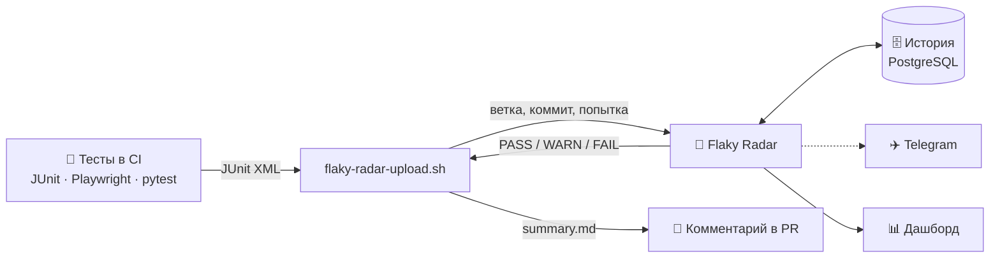

<div align="center">

# 📡 Flaky Radar

**Упал тест: это вы что-то сломали или он снова «моргнул»?**
Flaky Radar отвечает на этот вопрос автоматически по каждому прогону CI.

[](https://github.com/doub1educk/library-test-framework/actions/workflows/tests.yml)
[](https://doub1educk.github.io/library-test-framework/flaky-radar/jacoco/)


[Allure-отчёт](https://doub1educk.github.io/library-test-framework/flaky-radar/) ·
[Покрытие](https://doub1educk.github.io/library-test-framework/flaky-radar/jacoco/) ·
[CI](https://github.com/doub1educk/library-test-framework/actions) ·
[Сценарий демо](docs/demo.md)

</div>

---

## ✨ Возможности

| | |
|---|---|
| 📥 **Принимает любые JUnit XML** | JUnit/Surefire, Playwright, pytest: одним запросом из любого CI |
| 🕓 **Помнит историю** | каждый результат каждого теста хранится в PostgreSQL |
| 🎲 **Находит нестабильные тесты** | прошёл после повтора, на одном коммите и проходил, и падал, или часто переключается pass ↔ fail |
| 🧬 **Группирует ошибки** | порты, UUID, даты и адреса вычищаются, и одна причина у двадцати тестов становится одной группой |
| ⚖️ **Выносит вердикт** | по каждому падению: новое, известный флаки или давно сломан |
| 🚦 **Решает за CI** | `PASS` / `WARN` / `FAIL`: флаки не блокируют сборку, новые падения блокируют |
| 🧊 **Карантин** | тест в карантине не валит сборку, решение пересчитывается сразу |
| 📊 **Показывает** | дашборд, сводка в комментарий PR и Job Summary, уведомления в Telegram |

## 🔄 Как это работает



1. CI прогоняет тесты и отправляет отчёт в Flaky Radar.
2. Сервис сравнивает результаты с историей и выносит вердикт по каждому падению.
3. CI получает решение gate: `FAIL` останавливает сборку, `WARN` пропускает её с предупреждением.
4. Сводка появляется в PR, в Telegram и на дашборде.

## 🚀 Быстрый старт

Нужны **Docker**, **JDK 25** и **Maven 3.9+**.

```bash
mvn -pl flaky-radar -am package -DskipTests
docker compose --profile app up -d --build
```

Готово:

| | |
|---|---|
| Дашборд | http://localhost:8080 |
| Swagger UI | http://localhost:8080/swagger-ui.html |

<details>
<summary>Запуск без Docker-образа сервиса (для разработки)</summary>

```bash
docker compose up -d radar-db               # PostgreSQL на порту 5433
mvn -pl flaky-radar -am spring-boot:run
```
</details>

## 🔌 Подключить свой проект

**1. Создайте проект** и сохраните API-ключ: он показывается только один раз.

```bash
curl -X POST http://localhost:8080/api/v1/projects \
  -H "X-Admin-Token: change-me" -H "Content-Type: application/json" \
  -d '{"key":"shop","name":"Интернет-магазин"}'
# {"key":"shop","name":"Интернет-магазин","apiKey":"frk_..."}
```

**2. Добавьте шаг в CI** после тестов. Пример для GitHub Actions:

```yaml
- name: Flaky Radar
  if: always()
  env:
    RADAR_URL: ${{ secrets.RADAR_URL }}
    RADAR_PROJECT: shop
    RADAR_API_KEY: ${{ secrets.RADAR_API_KEY }}
  run: bash scripts/flaky-radar-upload.sh target/surefire-reports
```

Скрипт сам возьмёт ветку, коммит, номер попытки и id прогона из переменных GitHub Actions,
сохранит сводку в `radar-summary.md` и завершится с кодом `1`, если решение `FAIL`.

<details>
<summary>Переменные скрипта</summary>

| Переменная | Обязательна | По умолчанию |
|---|---|---|
| `RADAR_URL` | да | |
| `RADAR_PROJECT` | да | |
| `RADAR_API_KEY` | да | |
| `RADAR_BRANCH` | | `GITHUB_HEAD_REF` / `GITHUB_REF_NAME` / текущая ветка git |
| `RADAR_COMMIT` | | `GITHUB_SHA` / текущий коммит |
| `RADAR_ATTEMPT` | | `GITHUB_RUN_ATTEMPT` или `1` |
| `RADAR_CI_RUN` | | `GITHUB_RUN_ID` |
| `RADAR_BUILD_URL` | | ссылка на прогон GitHub Actions |
| `RADAR_ENFORCE` | | `true`: при `false` скрипт не валит сборку |

Скрипту нужны `curl` и `jq`.
</details>

## 🧠 Как принимаются решения

**Тест считается нестабильным (флаки)**, если:
- он прошёл только после повтора внутри прогона;
- на одном и том же коммите он и проходил, и падал;
- в последних 30 результатах у него не меньше 3 переключений pass ↔ fail (при 5+ результатах).

**Вердикт по упавшему тесту:**

| Вердикт | Когда |
|---|---|
| 🟡 `KNOWN_FLAKY` | тест помечен нестабильным или уже проходил на этом коммите |
| 🟠 `LONG_BROKEN` | третье падение подряд на этой ветке |
| 🔴 `NEW_FAILURE` | всё остальное: похоже, сломали именно сейчас |

**Решение для CI:**

| Gate | Когда |
|---|---|
| ✅ `PASS` | падений нет |
| ⚠️ `WARN` | падают только флаки или тесты в карантине |
| ❌ `FAIL` | есть `NEW_FAILURE` или `LONG_BROKEN` вне карантина |

Пороги настраиваются в `flaky-radar.detection.*` (`application.yml`).

## 📚 API

Полное описание: Swagger UI на `/swagger-ui.html`. Ошибки отдаются в формате Problem Details (RFC 9457).

| Метод | Путь | Что делает |
|---|---|---|
| `POST` | `/api/v1/projects` | создать проект 🔑 `X-Admin-Token` |
| `POST` | `/api/v1/projects/{key}/runs` | загрузить отчёт 🔑 `X-Api-Key` |
| `GET` | `/api/v1/projects/{key}/runs` | последние прогоны (`?branch=`) |
| `GET` | `/api/v1/projects/{key}/runs/{id}/gate` | решение для CI |
| `GET` | `/api/v1/projects/{key}/runs/{id}/summary.md` | сводка для PR |
| `GET` | `/api/v1/projects/{key}/tests?flaky=true` | нестабильные тесты |
| `GET` | `/api/v1/projects/{key}/tests/{id}/history` | история теста |
| `GET` | `/api/v1/projects/{key}/signatures` | группы ошибок |
| `POST` / `DELETE` | `/api/v1/projects/{key}/quarantine` | карантин 🔑 `X-Api-Key` |

Повторная загрузка того же прогона (`ciRunId` + `attempt`) не создаёт дубль, поэтому перезапуск CI безопасен.

## ⚙️ Настройки

| Переменная окружения | Назначение | По умолчанию |
|---|---|---|
| `FLAKY_RADAR_ADMIN_TOKEN` | токен для создания проектов | `change-me` ⚠️ смените |
| `FLAKY_RADAR_PUBLIC_URL` | адрес сервиса для ссылок в сводках | `http://localhost:8080` |
| `SPRING_DATASOURCE_URL` | адрес PostgreSQL | `jdbc:postgresql://localhost:5433/flakyradar` |
| `FLAKY_RADAR_TELEGRAM_ENABLED` | включить уведомления | `false` |
| `FLAKY_RADAR_TELEGRAM_BOT_TOKEN` | токен бота | |
| `FLAKY_RADAR_TELEGRAM_CHAT_ID` | чат для уведомлений | |

В Telegram уходят только прогоны с падениями, зелёные не беспокоят.

## 🛠️ Для разработчиков

```
pom.xml            общие версии и плагины
├── flaky-radar/     сервис
├── test-framework/  общий тестовый фреймворк (Testcontainers, RestAssured + Allure, JUnitXmlBuilder, ArchUnit)
├── library-demo/    демо-проект «Библиотека»: в CI отправляет свои тесты в Flaky Radar
└── scripts/         flaky-radar-upload.sh
```

```bash
mvn verify                                    # все тесты и покрытие (нужен Docker)
mvn -pl flaky-radar -am test -Dgroups=unit    # только быстрые unit-тесты
mvn -pl flaky-radar allure:serve              # Allure-отчёт локально
```

Тесты разделены по уровням: `unit`, `slice`, `api`, `architecture`. В CI джоб `dogfood` запускает тесты
«Библиотеки» дважды на одном коммите, и Flaky Radar сам находит в них нестабильный тест.

**Стек:** Java 25 · Spring Boot 3.5 · PostgreSQL 17 · Flyway · Thymeleaf · JUnit 5 · Testcontainers ·
RestAssured · WireMock · ArchUnit · Allure · JaCoCo · PIT · GitHub Actions
