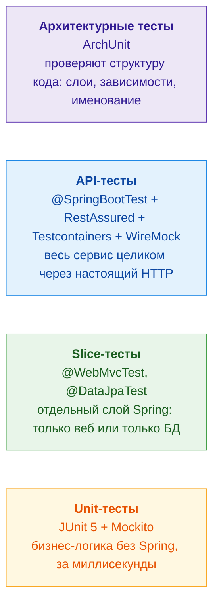
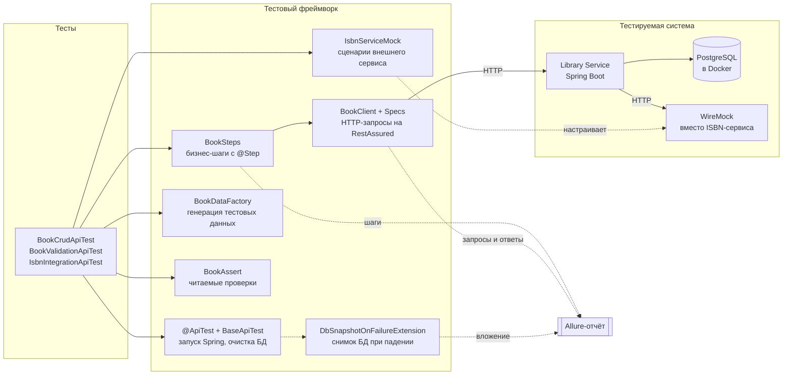
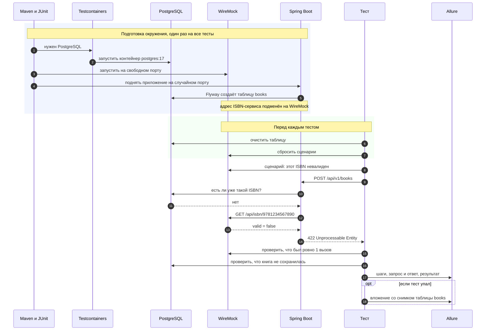

# Library Service + Test Automation Framework

[](https://github.com/doubleduck1/library-test-framework/actions/workflows/tests.yml)
[](https://doubleduck1.github.io/library-test-framework/jacoco/)


REST-сервис «Библиотека» на Spring Boot и тестовый фреймворк вокруг него:
unit, slice, API и архитектурные тесты, реальная БД в Docker, эмуляция внешнего сервиса
и подробный Allure-отчёт, который обновляется автоматически при каждом коммите.

## Посмотреть без запуска

| Что | Ссылка |
|---|---|
| **Allure-отчёт**: все тесты, шаги, HTTP-запросы и ответы | **https://doubleduck1.github.io/library-test-framework/** |
| Покрытие кода (JaCoCo) | https://doubleduck1.github.io/library-test-framework/jacoco/ |
| История прогонов в CI | [GitHub Actions](https://github.com/doubleduck1/library-test-framework/actions) |

### Как выглядит отчёт

**Обзор прогона:** сколько тестов, тренд по прошлым запускам, окружение.


**Один тест изнутри:** шаги, отправленный запрос и полученный ответ.


**Упавший тест:** категория ошибки, все расхождения и снимок БД во вложении.


---

## Уровни тестирования

Чем выше уровень, тем больше частей системы участвует в тесте и тем он медленнее.
Чем ниже, тем тест быстрее и точнее указывает на место ошибки.



| Уровень | Тестов | Что проверяется |
|---|---|---|
| Unit | 6 | правила сервиса: дубликаты ISBN, порядок проверок, ошибки «не найдено» |
| Slice: веб | 3 | валидация запросов, коды ответов, формат ошибок |
| Slice: БД | 3 | миграции Flyway, поиск без учёта регистра, уникальность ISBN в PostgreSQL |
| API | 20 | CRUD, 8 видов некорректных данных, отказы и таймауты внешнего сервиса |
| Архитектура | 6 | контроллеры не ходят в репозитории, сущности не утекают в API и т.д. |

## Устройство тестового фреймворка

Тест описывает **что** проверяется, а фреймворк берёт на себя **как**: запуск окружения,
HTTP, данные, проверки и отчётность.



| Компонент | Зачем нужен |
|---|---|
| `@ApiTest` | одна аннотация вместо пяти: Spring на случайном порту, БД в Docker, расширения |
| `BaseApiTest` | перед каждым тестом чистая БД и сброшенный мок, тесты не влияют друг на друга |
| `BookClient`, `Specs` | URL, порт, заголовки и логирование в Allure описаны один раз |
| `BookSteps` | действия на языке предметной области; каждое видно в отчёте как шаг |
| `BookDataFactory` | каждый тест получает уникальные данные; наборы негативных кейсов |
| `BookAssert` | `assertThat(book).hasGeneratedId().matches(request)`, показывает все расхождения сразу |
| `IsbnServiceMock` | одной строкой: «сервис говорит невалидно», «отвечает 500», «тормозит» |
| `DbSnapshotOnFailureExtension` | при падении прикладывает к отчёту содержимое таблицы |

## Что происходит при запуске API-теста

На примере теста «внешний сервис считает ISBN невалидным».



---

## Быстрый старт

Нужно: JDK 25, Maven 3.9+, запущенный Docker.

```bash
mvn test              # все тесты
mvn allure:serve      # открыть отчёт в браузере
```

Запуск самого приложения:

```bash
docker compose up -d  # PostgreSQL + заглушка ISBN-сервиса
mvn spring-boot:run   # Swagger: http://localhost:8080/swagger-ui.html
```

### Наборы тестов

```bash
mvn test -Dgroups=unit
mvn test -Dgroups=smoke
mvn test -Dgroups=api
mvn test -Dgroups=demo -DexcludedGroups=none   # намеренно падающий демо-тест
mvn verify                                     # тесты + проверка покрытия (>= 70%)
mvn -Pmutation test-compile org.pitest:pitest-maven:mutationCoverage   # мутационное тестирование
```

## Стек

| Часть | Технологии |
|---|---|
| Приложение | Java 25, Spring Boot 3.5 (Web MVC, Data JPA, Validation, Actuator), PostgreSQL, Flyway, springdoc-openapi |
| Тесты | JUnit 5, Mockito, AssertJ, RestAssured, JSON Schema, Testcontainers, WireMock, Datafaker, ArchUnit |
| Отчёты | Allure, JaCoCo, PIT |
| CI | GitHub Actions, GitHub Pages |

## Структура

```
src/main/java/ru/study/library/
├── book/           контроллер, сервис, репозиторий, сущность, DTO
├── isbn/           клиент внешнего сервиса проверки ISBN
└── web/            единая обработка ошибок (Problem Details)

src/test/java/ru/study/library/
├── framework/      тестовый фреймворк (см. схему выше)
├── unit/           тесты бизнес-логики на моках
├── slice/          тесты веб-слоя и слоя данных
├── api/            сквозные тесты через HTTP
└── architecture/   архитектурные правила
```

## Запуск из IntelliJ IDEA

1. File → Open → `pom.xml` → Open as Project.
2. File → Project Structure → SDK: 25.
3. Docker должен быть запущен.
4. Чтобы `@Step` попадали в Allure, запускай тесты через Maven (панель Maven → Lifecycle → test)
   или добавь в шаблон JUnit-конфигурации VM option
   `-javaagent:<~/.m2>/repository/org/aspectj/aspectjweaver/1.9.25.1/aspectjweaver-1.9.25.1.jar`.
